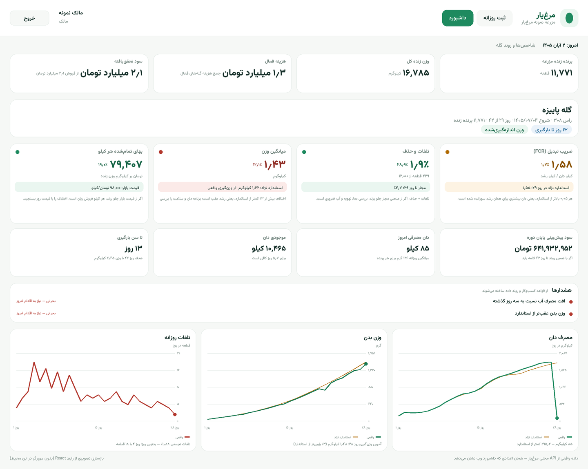

# معماری مرغ‌یار

این سند هشت بخش دارد و **از خودِ کد تولید و بررسی می‌شود**، نه از حافظه:

| بخش | منبع |
|---|---|
| [۱. معماری کلی](#۱-معماری-کلی) | ساختار ورک‌اسپیس + کد ماژول‌ها |
| [۲. طرح پایگاه‌داده](#۲-طرح-پایگاه‌داده) | [`schema.sql`](./schema.sql) — از پایگاه‌داده واقعی پس از مهاجرت‌ها |
| [۳. ساختار پوشه‌ها](#۳-ساختار-پوشه‌ها) | درخت واقعی مخزن |
| [۴. کد سه ماژول کلیدی](#۴-کد-سه-ماژول-کلیدی) | `logs.service.ts`، `metrics.ts`، `services.py` |
| [۵. مشخصات API](#۵-مشخصات-api) | [`openapi.yaml`](./openapi.yaml) — از `/api/docs-json` |
| [۶. طرح صفحه](#۶-طرح-صفحه-wireframe-متنی) | کامپوننت‌های واقعی وب و موبایل |
| [۷. نقشه راه](#۷-نقشه-راه-فازبندی‌شده) | وضعیت فازها + کارهای باقی‌مانده |
| [۸. محدودیت‌ها](#۸-محدودیت‌ها) | سنجه‌های کد + `npm run check:security` + `npm test` |

بازتولید بخش‌های ماشینی:

```bash
npm run docs:schema                 # DDL از پایگاه‌داده پس از اجرای مهاجرت‌ها
API_URL=http://127.0.0.1:4000 npm run docs:openapi   # از سرور در حال اجرا
```

---

## ۱. معماری کلی

### نمودار لایه‌ها

> نمودار با فونت یکنواخت (monospace) رسم شده است؛ جای جعبه‌ها معنادار است،
> جهت خواندن هر ردیف از چپ به راست است. در رابط کاربری، همه‌چیز راست‌به‌چپ است.

```
                            ┌────────────────────────────────────────────┐
                            │                 کاربران                    │
                            │  مالک/مدیر (داشبورد) · کارگر (گوشی) · دامپزشک │
                            └───────────────┬────────────────────────────┘
                                            │
        ┌───────────────────┬───────────────┴────────────────┬──────────────────┐
        ▼                   ▼                                ▼                  ▼
┌───────────────┐  ┌────────────────┐              ┌─────────────────┐  ┌──────────────┐
│ apps/web      │  │ apps/mobile    │              │ docs/demo       │  │ گزارش‌ها      │
│ React + Vite  │  │ Expo + SQLite  │              │ صفحه نمایشی     │  │ Excel / PDF  │
│ Tailwind      │  │ آفلاین‌فرست     │              │ (فقط با فلگ)    │  │ (از API)     │
│ Recharts      │  │ صف همگام‌سازی   │              └─────────────────┘  └──────────────┘
└───────┬───────┘  └───────┬────────┘
        │  /api/v1 (نسبی)  │  /api/v1 + /sync/push + /sync/pull
        └──────────┬───────┘
                   ▼
        ┌──────────────────────────────┐        ┌────────────────────────────┐
        │  apps/api — NestJS 11        │        │ services/ai — FastAPI      │
        │  ─────────────────────────   │  HTTP  │ ─────────────────────────  │
        │  auth (JWT + RBAC)           │ ─────► │ منحنی نژاد · وزن پایان دوره │
        │  farms/halls/flocks          │ ◄───── │ تاریخ بهینه بارگیری         │
        │  logs · weights · expenses   │  JSON  │ هشدار زودهنگام بیماری       │
        │  sales · inventory           │        │ تبدیل گفتار (اختیاری)      │
        │  analytics · reminders       │        └────────────────────────────┘
        │  reports (xlsx/pdf)          │                     ▲
        │  assistant · sync            │                     │ اگر پاسخ نداد:
        └───────────┬──────────────────┘                     │ همان محاسبه در
                    │                                        │ بسته دامنه (TS)
                    ▼                                        │ با fallback:true
        ┌──────────────────────────────┐                     │
        │  packages/domain (TypeScript)│─────────────────────┘
        │  ─ بدون فریم‌ورک، بدون I/O ─ │
        │  استانداردها و منحنی نژاد     │
        │  محاسبات رشد/FCR/هزینه       │
        │  تقویم شمسی · قالب‌بندی فارسی  │
        │  ماتریس دسترسی نقش‌ها          │
        │  صف آفلاین · برنامه اعلان     │
        │  تجزیه جمله فارسی (دستیار)    │
        └───────────┬──────────────────┘
                    │ Drizzle ORM
                    ▼
        ┌──────────────────────────────┐   ┌─────────────┐   ┌──────────────┐
        │ PostgreSQL (PGlite در توسعه) │   │ Redis       │   │ S3           │
        │ ۱۵ جدول · مهاجرت SQL · تراکنش │   │ (فاز بعد)   │   │ (فاز بعد)    │
        └──────────────────────────────┘   └─────────────┘   └──────────────┘
```

### قانون‌های معماری (آنچه هرگز نقض نمی‌شود)

۱. **محاسبه یک‌جا، نمایش چندجا.** فرمول FCR، منحنی استاندارد نژاد، هزینه هر
کیلو، سهم تلفات مجاز و قواعد هشدار فقط در `packages/domain` نوشته شده‌اند.
API همان کد را اجرا می‌کند، وب و موبایل هم همان را برای نمایش/پیش‌بینی محلی
می‌خوانند. نتیجه: عدد داشبورد، عدد PDF و عدد گوشی هرگز با هم اختلاف ندارند.

۲. **API هرگز به سرویس AI وابسته نیست.** `apps/api` اول سرویس پایتون را با
مهلت کوتاه صدا می‌زند؛ اگر جواب نداد یا کند بود، همان محاسبه را با بسته دامنه
انجام می‌دهد و پاسخ را با `fallback: true` برمی‌گرداند. قطعی AI نباید ثبت
داده یا دیدن داشبورد را متوقف کند.

۳. **موبایل آفلاین‌فرست است.** نوشتن در SQLite گوشی «موفق» است؛ ارسال به
سرور کار پس‌زمینه است. صف عملیات idempotent است (`sync_receipts`) و تعارض با
`updated_at` و وضعیت «در صف» حل می‌شود.

۴. **دسترسی در سرور اعمال می‌شود، نه در رابط کاربری.** ماتریس نقش در بسته
دامنه است (تا موبایل آفلاین هم بداند)، اما تصمیم نهایی با `RolesGuard` در API
است و داده مالی برای نقش‌های بدون `cost:read` حتی از پاسخ حذف می‌شود.

۵. **داده حذف نمی‌شود، علامت می‌خورد.** `deleted_at` + `updated_at` در همه
جدول‌های عملیاتی؛ هم برای بازیابی، هم برای رساندن «حذف» به گوشی‌های دیگر.

### جریان چند درخواست نمونه

| سناریو | مسیر |
|---|---|
| داشبورد | `GET /analytics/overview` → خواندن ۵ جدول → `computeMetrics` در دامنه → JSON با ۶۷ فیلد شاخص برای هر گله |
| ثبت روزانه | `POST /flocks/:id/logs` → اعتبارسنجی (تاریخ آینده، تلفات > زنده، ظرفیت) → upsert یکتا روی (گله، تاریخ) + کسر انبار در همان تراکنش |
| ثبت آفلاین | گوشی: SQLite → صف → `POST /sync/push` (idempotent) → `GET /sync/pull?since=` → ادغام |
| پیش‌بینی وزن | `GET /ai/flocks/:id/forecast` → ساخت سری وزن‌ها از دامنه → FastAPI (گومپرتز/منحنی نژاد) → در صورت خطا/تأخیر: محاسبه محلی + `fallback:true` |
| گزارش | `GET /reports/flocks/:id/export?format=xlsx\|pdf` → همان متریک‌ها → ExcelJS/pdfkit با فونت RTL |
| دستیار فارسی | `POST /assistant/message` → تجزیه محلی (دامنه) → پیش‌نویس + `needsConfirmation` → `POST /assistant/confirm` → ثبت واقعی با RBAC |

---

## ۲. طرح پایگاه‌داده

فایل کامل و اجراپذیر: **[`schema.sql`](./schema.sql)** (از پایگاه‌داده‌ی واقعی
پس از اجرای چهار مهاجرت تولید شده است — نه دست‌نویس).

**۱۵ جدول دامنه** (به‌علاوه `_migrations` فنی) در چهار گروه:

| گروه | جدول‌ها | نکته کلیدی |
|---|---|---|
| هویت و دسترسی | `users`, `farms`, `farm_members`, `farm_settings`, `refresh_tokens` | نقش در `farm_members` است، نه `users`؛ یک کاربر می‌تواند در چند مزرعه نقش متفاوت داشته باشد |
| ساختار پرورش | `halls`, `flocks`, `daily_logs`, `weight_samples`, `vaccinations`, `medications` | `halls` جدول مستقل است (نه ستون متنی)؛ `weight_samples` جدول مستقل با یکنواختی/CV |
| عملیات و مالی | `expenses`, `sales`, `feed_inventory` | `feed_inventory` یک «دفتر» است: خرید و مصرف هر دو تراکنش ثبت می‌شوند |
| فنی | `sync_receipts` | رسید idempotency همگام‌سازی موبایل |

### تصمیم‌های مهم

**۱. واحد پول: تومان، بدون اعشار.** همه مبالغ `numeric(14,0)`؛ وزن‌ها و
کمیت‌ها `numeric(12,2)`. دلیل: ریال در عمل سه صفر اضافه و منبع خطای گزارش است.

**۲. یک ثبت روزانه برای هر (گله، تاریخ).** هم ایندکس یکتا، هم upsert سمت
سرور، هم کلید محلی گوشی (نه شناسه سرور) — تا «ثبت امروز دوباره» رکورد دوم نسازد.

**۳. حذف نرم + `updated_at` در همه جدول‌های عملیاتی.** ستون‌های
`deleted_at`/`updated_at` مبنای همگام‌سازی افزایشی (`since`) هستند.

**۴. `farm_settings` آستانه‌ها را نگه می‌دارد.** `daily_mortality_alert_pct`
(پیش‌فرض ۰٫۵)، `water_drop_alert_pct` (پیش‌فرض ۱۰)، قیمت بازار و دان،
`timezone`. هشدارها از همین‌ها ساخته می‌شوند و قابل تنظیم‌اند.

**۵. `sync_receipts` کلید اصلی امنیت داده آفلاین است.** برای هر عملیات
(`client_id`) یک ردیف؛ اگر همان عملیات دوباره برسد، پاسخ `duplicate` می‌گیرد.

**۶. کلیدهای خارجی با `ON DELETE CASCADE` برای داده فرزند و
`RESTRICT/NO ACTION` برای موجودیت‌های مرجع.** حذف گله، ثبت‌هایش را می‌برد؛
حذف کاربری که ثبت دارد مسدود می‌شود.

نمونه‌ای از فایل تولیدشده:

```sql
CREATE TABLE daily_logs (
  id text NOT NULL,
  flock_id text NOT NULL,
  date date NOT NULL,
  mortality integer DEFAULT 0 NOT NULL,
  cull integer DEFAULT 0 NOT NULL,
  feed_kg numeric(12,2) DEFAULT 0 NOT NULL,
  water_liter numeric(12,2) DEFAULT 0 NOT NULL,
  avg_temp numeric(5,1) NULL,
  feed_type text NULL,
  notes text NULL,
  created_by text NULL,
  created_at timestamptz DEFAULT now() NOT NULL,
  updated_at timestamptz DEFAULT now() NOT NULL,
  deleted_at timestamptz NULL,
  PRIMARY KEY (id)
);

CREATE UNIQUE INDEX daily_logs_flock_date_uq ON public.daily_logs USING btree (flock_id, date);

ALTER TABLE daily_logs ADD CONSTRAINT daily_logs_cycle_id_fkey
  FOREIGN KEY (flock_id) REFERENCES flocks(id) ON DELETE CASCADE;
```

> اگر به فرم Prisma نیاز دارید، نگاشت معادل چنین است (فقط برای مقایسه؛
> منبع حقیقت `schema.sql` است):
>
> ```prisma
> model DailyLog {
>   id         String    @id @default(uuid())
>   flockId    String    @map("flock_id")
>   date       DateTime  @db.Date
>   mortality  Int       @default(0)
>   cull       Int       @default(0)
>   feedKg     Decimal   @map("feed_kg")      @db.Decimal(12, 2)
>   waterLiter Decimal   @map("water_liter")  @db.Decimal(12, 2)
>   avgTemp    Decimal?  @map("avg_temp")     @db.Decimal(5, 1)
>   deletedAt  DateTime? @map("deleted_at")
>   flock      Flock     @relation(fields: [flockId], references: [id], onDelete: Cascade)
>   @@unique([flockId, date])
>   @@map("daily_logs")
> }
> ```
>
> در این پروژه عمداً Prisma انتخاب نشده: SQL خام + Drizzle اجازه می‌دهد
> مهاجرت‌ها تراکنشی و قابل بازبینی بمانند و در PGlite (WASM) هم اجرا شوند.

---

## ۳. ساختار پوشه‌ها

```
platform/
├── packages/domain/                 منطق مشترک — بدون فریم‌ورک، بدون I/O
│   ├── src/
│   │   ├── types.ts                 مدل‌های دامنه (Flock, DailyLog, …) + برچسب نقش‌ها
│   │   ├── standards.ts             جدول استاندارد راس ۳۰۸ (وزن، دان تجمعی، FCR)
│   │   ├── breeds.ts                منحنی چهار نژاد + تشخیص نام فارسی/انگلیسی
│   │   ├── metrics.ts               قلب سیستم: FCR، تلفات، هزینه هر کیلو، هشدارها، سری روزانه
│   │   ├── uniformity.ts            یکنواختی گله از نمونه‌های وزن (CV و دامنه)
│   │   ├── jalali.ts                تقویم شمسی (تبدیل، تاریخ امروز به وقت مزرعه)
│   │   ├── format.ts                قالب‌بندی فارسی اعداد/تومان/درصد/وزن
│   │   ├── permissions.ts           ماتریس دسترسی نقش‌ها (منبع واحد API/وب/موبایل)
│   │   ├── offline.ts               صف آفلاین، تلاش دوباره، ادغام تعارض، خلاصه نوار وضعیت
│   │   ├── notifications.ts         برنامه‌ریزی اعلان (ساکت شبانه، واکسن، پرهیز دارو)
│   │   └── persian-intent.ts        تجزیه جمله فارسی دستیار (ثبت/هزینه/فروش/وزن/پرسش)
│   └── tests/                       ۹۹ تست (node:test + tsx)
│
├── apps/api/                        NestJS 11 + Drizzle + PostgreSQL/PGlite
│   ├── src/
│   │   ├── auth/                    ورود/تازه‌سازی/خروج، JwtAuthGuard، RolesGuard
│   │   ├── common/                  mappers، خطای اعتبارسنجی فارسی، دسترسی به گله، نقش‌ها
│   │   ├── db/                      اتصال، schema (Drizzle)، migrate، seed، migrations/*.sql
│   │   ├── farms/ halls/ flocks/    موجودیت‌های اصلی
│   │   ├── logs/                    ثبت روزانه (upsert + انبار)
│   │   ├── weight-samples/          وزن‌گیری نمونه‌ای + یکنواختی
│   │   ├── expenses/ sales/         مالی
│   │   ├── inventory/               دفتر انبار دان
│   │   ├── health/                  واکسن، دارو، دوره پرهیز
│   │   ├── analytics/               شاخص‌ها (و حذف فیلد مالی برای نقش محدود)
│   │   ├── reminders/               کارهای امروز و هشدارها
│   │   ├── reports/                 خروجی Excel و PDF (RTL)
│   │   ├── ai/                      کلاینت FastAPI + جایگزین محلی
│   │   ├── assistant/               دستیار فارسی متن/صدا
│   │   └── sync/                    push/pull آفلاین با رسید idempotent
│   └── test/app.e2e.spec.ts         ۱۰۵ تست یکپارچه روی PGlite
│
├── apps/web/                        داشبورد — React 18 + Vite 6 + Tailwind 3 + Recharts
│   ├── src/
│   │   ├── pages/                   LoginPage · TodayPage (کارگر) · DashboardPage
│   │   ├── components/              AppShell، KpiCard، charts، AlertList، BigNumberField
│   │   ├── lib/                     api، types، format، kpi، series، nav
│   │   └── test/                    آزمون رندر با jsdom
│   └── vite.config.ts               پروکسی /api → API، پیکربندی Vitest
│
├── apps/mobile/                     Expo (React Native) + SQLite
│   ├── App.tsx                      ناوبری، بوت از حافظه محلی، همگام‌سازی دوره‌ای
│   └── src/
│       ├── api/                     fetch + توکن (SecureStore) + تفکیک خطای شبکه
│       ├── storage/                 SQLite: صف، ثبت‌ها، گله‌ها، یادآورها
│       ├── sync/                    چسب صف ↔ API (منطق در بسته دامنه)
│       ├── notifications/           زمان‌بندی اعلان محلی
│       ├── screens/                 ورود، خانه، ثبت سریع، صف، تنظیمات
│       └── components/              کارت، دکمه بزرگ، صفحه‌کلید عددی فارسی
│
├── services/ai/                     FastAPI (پایتون) — اختیاری ولی مستقل
│   ├── app/main.py                  مسیرها + سلامت + احراز کلید اختیاری
│   ├── app/services.py              گومپرتز، بارگیری، ریسک بیماری، پیش‌بینی دان
│   ├── app/breeds.py                منحنی نژادها (هم‌ارز TS)
│   └── app/speech.py                تبدیل گفتار (faster-whisper/vosk، اختیاری)
│
├── scripts/
│   ├── import-legacy.mjs            انتقال داده از نسخه SQLite قدیمی
│   ├── dump-schema.mts              تولید docs/architecture/schema.sql
│   └── fetch-openapi.mjs            تولید docs/architecture/openapi.yaml
│
├── docs/
│   ├── architecture/                همین سند + schema.sql + openapi.yaml
│   ├── demo/                        صفحه نمایشی فارسی (فقط با SERVE_DEMO=1)
│   └── samples/                     نمونه خروجی Excel/PDF
│
├── docker-compose.yml               postgres + redis + api
└── package.json                     ورک‌اسپیس‌ها و اسکریپت‌های ریشه
```

**قاعده‌ی وابستگی:** `web` و `mobile` و `api` → `domain`. هیچ‌کدام به هم
وابسته نیستند. `api` → `services/ai` فقط از راه HTTP و **اختیاری**.

---

## ۴. کد سه ماژول کلیدی

### ۴.۱. ثبت روزانه (`apps/api/src/logs/logs.service.ts`)

مسئله: کارگر روزی یک‌بار ثبت می‌کند، ولی گاهی دوباره (اصلاح عدد) ثبت می‌کند؛
ممکن است دو گوشی هم‌زمان بفرستند. ثبت تکراری نباید رکورد دوم بسازد و نباید
موجودی انبار را دوبار کم کند.

```ts
async save(farmId: string, userId: string, flockId: string, dto: SaveLogDto, timezone = "Asia/Tehran") {
  const flock = await this.access.require(farmId, flockId);   // گله متعلق به همین مزرعه؟
  const today = todayIso(timezone);
  const errors: Record<string, string> = {};

  if (dto.date > today) errors.date = "ثبت تاریخ آینده مجاز نیست.";
  if (dto.date < flock.start_date) errors.date = "تاریخ پیش از جوجه‌ریزی گله است.";
  if (flock.closed_date && dto.date > flock.closed_date)
    errors.date = "گله بسته شده و ثبت تاریخ بعد از آن مجاز نیست.";

  const existing = await this.db.select().from(dailyLogs)
    .where(and(eq(dailyLogs.flockId, flockId), eq(dailyLogs.date, dto.date))).limit(1);

  const liveBefore = await this.liveBirdsAt(farmId, flockId, dto.date);
  const lostNow = dto.mortality + (dto.cull ?? 0);
  if (lostNow > liveBefore)
    errors.mortality = `تلفات و حذف از تعداد زنده (${liveBefore} قطعه) بیشتر است.`;
  assertValid(errors, "ثبت انجام نشد؛ مقادیر را بررسی کنید.");

  await this.db.transaction(async (tx: any) => {
    if (previous) {
      await tx.update(dailyLogs).set({ ...values, deletedAt: null, updatedAt: new Date() })
        .where(eq(dailyLogs.id, previous.id));
    } else {
      // clientId از گوشی = شناسه رکورد؛ ارسال دوباره صف همان رکورد را می‌نویسد
      const id = dto.clientId && /^[0-9a-zA-Z_-]{8,64}$/.test(dto.clientId) ? dto.clientId : randomUUID();
      await tx.insert(dailyLogs).values({ id, ...values })
        .onConflictDoUpdate({ target: [dailyLogs.flockId, dailyLogs.date], set: { ...values, updatedAt: new Date() } });
    }

    // انبار: برگرداندن مصرف قبلی، کسر مصرف جدید — ویرایش، موجودی را دوبار کم نمی‌کند
    if (previous && !previous.deletedAt) {
      await this.inventory.add(tx, farmId, previous.feedType ?? feedType, n(previous.feedKg));
    }
    await this.inventory.add(tx, farmId, feedType, -dto.feedKg);
  });

  const saved = await this.db.select().from(dailyLogs)
    .where(and(eq(dailyLogs.flockId, flockId), eq(dailyLogs.date, dto.date))).limit(1);
  return { ...toLog(saved[0]), updated: Boolean(previous) };
}
```

**چهار تضمین این تابع:** ① یک رکورد در هر روز (ایندکس یکتا + upsert)؛
② رد تاریخ آینده و تلفات بیشتر از موجودی، با پیام فارسیِ همان فیلد؛
③ انبار در همان تراکنش اصلاح می‌شود (اختلاف مقدار قبلی و جدید)؛
④ `clientId` گوشی به‌عنوان شناسه رکورد، پس ارسال دوباره بی‌خطر است.

---

### ۴.۲. محاسبه FCR (`packages/domain/src/metrics.ts`)

مسئله: FCR یعنی چند کیلو دان برای چند کیلو رشد. اگر «وزن زنده فعلی» تنها
مخرج باشد، هر فروش میان‌دوره‌ای FCR را مصنوعاً بدتر نشان می‌دهد.

```ts
const liveBiomassKg = (liveBirds * currentWeightG) / 1000;
const soldWeightKg = sales.reduce((s, x) => s + (x.total_weight_kg || 0), 0);
const producedKg = liveBiomassKg + soldWeightKg;      // وزن زنده تولیدشده

// قاعده ۱: FCR = مجموع دان مصرفی ÷ مجموع وزن زنده تولیدشده
const fcr = totalFeedKg > 0 && producedKg > 0.001 ? totalFeedKg / producedKg : null;

// استاندارد گله: ضریب تبدیل نژاد با احتساب تلفات (خوراک پرندگان تلف‌شده)
const stdFcr = standardAt(ageDays).fcr * (1 + mortalityPct / 100);
```

مقایسه با استاندارد هم‌سن انجام می‌شود، نه با استاندارد پایان دوره؛ و
`stdFcr` اثر تلفات را اضافه می‌کند (پرنده‌ای که تلف شده دان خورده و رشد
نداده). مثال واقعی از داده نمونه:

| ورودی | مقدار |
|---|---|
| دان مصرفی تجمعی | ۲۶٬۵۳۵ کیلوگرم |
| پرنده زنده × وزن فعلی | ۱۱٬۷۷۱ × ۱٬۴۲۶ گرم = ۱۶٬۷۸۵ کیلوگرم |
| فروش میان‌دوره‌ای | ۰ کیلوگرم |
| **FCR محاسبه‌شده** | ۲۶٬۵۳۵ ÷ ۱۶٬۷۸۵ = **۱٫۵۸** |
| استاندارد نژاد در روز ۲۹ | ۱٫۵۵ × (۱ + ۱٫۸۸٪) = **۱٫۵۸** |

عدد در داشبورد، در PDF و در موبایل از همین تابع می‌آید. تست‌های دامنه
حالت‌های مرزی (بدون وزن، بدون دان، فروش میان‌دوره) را پوشش می‌دهند.

---

### ۴.۳. سرویس پیش‌بینی وزن (`services/ai/app/services.py` + جایگزین در API)

مسئله: با ۰ تا ۵ وزن‌گیری باید وزن پایان دوره (و در ادامه تاریخ بهینه
بارگیری) برآورد شود؛ سرویس AI هم ممکن است خاموش باشد.

```python
def forecast_weight(points, target_age, target_weight, breed_name=None):
    """پیش‌بینی وزن پایان دوره. خروجی: (روش، وزن، رشد روزانه، منحنی، یادداشت‌ها، نژاد)"""
    breed, _matched, breed_note = resolve_breed(breed_name)
    notes = [breed_note]
    points = sorted(points)

    if len(points) >= 2:                      # ① برازش گومپرتز روی داده واقعی
        model = fit_gompertz(points, target_weight)
        if model is not None:
            projected = model.predict(target_age)
            if 0.5 * target_weight <= projected <= 1.8 * target_weight:   # ② پلوس ماشین‌سنجی
                ...
                return "gompertz-fit", round(projected), round(daily, 1), curve, notes, breed.name_fa
        notes.append("برازش گومپرتز خارج از بازه معقول بود؛ منحنی استاندارد نژاد استفاده شد.")

    if len(points) == 1:                      # ③ یک وزن‌گیری: رشد استاندارد نژاد
        day, weight = points[0]
        gain = max(10.0, (standard_weight(day + 7, breed) - standard_weight(day, breed)) / 7)
        projected = weight + gain * max(0, target_age - day)
        ...

    return "standard-curve", ...              # ④ هیچ وزن‌گیری: منحنی نژاد
```

سمت NestJS، سرویس AI فقط «بهتر» است نه «لازم»:

```ts
async forecast(farmId: string, flockId: string): Promise<ForecastResult> {
  const { metrics, weights, ageOf } = await this.flockData(farmId, flockId);
  const remote = await this.post("/predict/weight", { /* weights, target, breed */ });

  if (remote) return { source: "ai", fallback: false, ... };   // پاسخ سرویس پایتون
  return this.localForecast(metrics);                          // fallback: source=local
}
```

`localForecast` همان منحنی **همان نژاد گله** را برمی‌دارد (نه همیشه راس)،
آخرین وزن اندازه‌گیری‌شده را روی منحنی جایگزین می‌کند و ضریب اطمینان را از
تعداد وزن‌گیری‌ها می‌سازد (`weighCount >= 3 ? 0.6 : 0.35`). خروجی هر دو مسیر
یک شکل دارد (`method`, `confidence`, `notes`, `curve[]` با `source`)، پس
داشبورد لازم نیست بداند پاسخ از کدام مسیر آمده — فقط برچسب «منبع: AI/محلی»
را نشان می‌دهد.

---

## ۵. مشخصات API

- پیشوند همه مسیرها: **`/api/v1`**
- سند تعاملی: **`GET /api/docs`** (Swagger UI) · سند ماشین‌خوان: `GET /api/docs-json`
- فایل ذخیره‌شده: **[`openapi.yaml`](./openapi.yaml)** — ۵۴ مسیر، ۷۴ عملیات، ۲۹ schema
- احراز هویت: `Authorization: Bearer <accessToken>` (JWT با تازه‌سازی)
- خطای اعتبارسنجی: `422/400` با ساختار یکسان `{ message, errors: { field: "پیام فارسی" } }`
- زبان پیام‌ها: فارسی — همان چیزی که کاربر نهایی می‌بیند، مستقیم قابل نمایش است.

### مرور مسیرها

| گروه | تعداد | مسیرها |
|---|---|---|
| `auth` | ۸ | `POST /auth/register` · `/login` · `/refresh` · `/logout` · `/change-password` · `/switch-farm` · `GET|PATCH /auth/me` |
| `farm` | ۹ | `GET|POST|PATCH /farm` · `GET|PATCH /farm/settings` · `GET|POST /farm/members` · `PATCH|DELETE /farm/members/:userId` |
| `halls` | ۵ | `GET|POST /halls` · `GET|PATCH|DELETE /halls/:id` |
| `flocks` | ۸ | `GET|POST /flocks` · `GET|PATCH|DELETE /flocks/:id` · `/flocks/:id/stats` · `/close` · `/reopen` |
| `logs` | ۳ | `GET|POST /flocks/:flockId/logs` · `DELETE /logs/:id` |
| `weights` | ۳ | `GET|POST /flocks/:flockId/weights` · `DELETE /:id` |
| `health` | ۸ | `GET /flocks/:flockId/health` · `GET|POST /vaccinations` · `PATCH|DELETE /vaccinations/:id` · `GET|POST /medications` · `DELETE /medications/:id` |
| `expenses` | ۴ | `GET|POST /flocks/:flockId/expenses` · `PATCH|DELETE /:id` |
| `sales` | ۳ | `GET|POST /flocks/:flockId/sales` · `DELETE /:id` |
| `inventory` | ۳ | `GET /farm/inventory` · `POST /farm/inventory/set` · `/adjust` |
| `analytics` | ۲ | `GET /analytics/overview` · `GET /analytics/flocks/:id` |
| `reminders` | ۲ | `GET /reminders?horizonDays=` · `GET /reminders/badge` |
| `reports` | ۴ | `GET /reports/flocks/:id` · `/export?format=xlsx\|pdf\|json` · `GET /reports/farm` · `/export` |
| `ai` | ۵ | `GET /ai/status` · `/ai/flocks/:id/forecast` · `/loading-date` · `/risk` · `/ai/farm/feed` |
| `assistant` | ۴ | `GET /assistant/examples` · `POST /assistant/message` · `/confirm` · `/voice` |
| `sync` | ۲ | `POST /sync/push` · `GET /sync/pull?since=` |
| `health` | ۱ | `GET /health` (بدون احراز هویت، برای liveness probe) |

### ماتریس نقش → مسیر (خلاصه)

| مسیر | owner | manager | worker | vet |
|---|:--:|:--:|:--:|:--:|
| ثبت روزانه/وزن، دیدن گله‌ها | ✅ | ✅ | ✅ | ✅ |
| هزینه و فروش | ✅ | ✅ | ❌ | ❌ |
| ساخت/ویرایش گله، سالن، تنظیمات | ✅ | ✅ | ❌ | ❌ |
| حذف گله، مدیریت اعضا | ✅ | ❌ | ❌ | ❌ |
| `analytics/overview` | ✅ کامل | ✅ کامل | ✅ بدون فیلد مالی | ✅ بدون فیلد مالی |

### دو قرارداد مهم

**۱. همگام‌سازی آفلاین**

```http
POST /api/v1/sync/push
{ "operations": [ { "clientId": "m-abc123xy", "type": "log.save",
                    "flockId": "flock-1", "payload": { "date": "2026-10-24",
                    "mortality": 3, "feedKg": 900 } } ] }

200 → { "serverTime": "…", "applied": 1, "duplicates": 0, "failed": 0,
        "results": [ { "clientId": "m-abc123xy", "status": "applied", "entityId": "…" } ] }
```

`type` ∈ `log.save | weight.create | expense.create | sale.create`.
ارسال دوباره همان `clientId` → `"status": "duplicate"` (بدون رکورد دوم).
خطای یک عملیات، بقیه صف را متوقف نمی‌کند.

**۲. پیش‌بینی با تضعیف تدریجی**

```http
GET /api/v1/ai/flocks/:id/forecast
200 → { "source": "ai" | "local", "fallback": false | true,
        "method": "gompertz-fit" | "standard-curve", "confidence": 0.6,
        "projectedWeightGr": 2532, "curve": [ … ] }
```

`fallback: true` یعنی سرویس پایتون در دسترس نبود و همان محاسبه در TS انجام
شد. هرگز ۵۰۳ به کاربر نمی‌دهد.

---

## ۶. طرح صفحه (Wireframe متنی)

### الف) داشبورد وب — برای مالک/مدیر

```
┌──────────────────────────────────────────────────────────────────────────────┐
│ 🐔 مرغ‌یار            مزرعه نمونه            [ امروز ] [ داشبورد ]      خروج │  ← سربرگ چسبان
├──────────────────────────────────────────────────────────────────────────────┤
│ امروز: جمعه ۱ آبان ۱۴۰۵ · شاخص‌ها و روند گله                                  │
│                                                                              │
│ ┌────────────┐ ┌────────────┐ ┌────────────┐ ┌────────────┐                  │
│ │ ضریب تبدیل │ │ تلفات و حذف│ │ میانگین وزن│ │ بهای هر کیلو│   ← ۴ KPI، رنگ مرزی │
│ │   ۱٫۵۸     │ │   ۱٫۹٪     │ │ ۱٫۴۳ کیلو │ │  ۷۹٬۴۰۷    │      سبز/زرد/قرمز   │
│ │ استاندارد ۱٫۵۵│ │ ۲۲۹ از ۱۲٬۰۰۰│ │ استاندارد ۱٫۶۲│ │ بازار ۹۸٬۰۰۰│              │
│ │ چرا: …     │ │ چرا: …     │ │ چرا: …     │ │ چرا: …     │   ← جمله‌ی راهنما     │
│ └────────────┘ └────────────┘ └────────────┘ └────────────┘                  │
│                                                                              │
│ [سود پیش‌بینی] [دان امروز] [موجودی دان] [تا بارگیری]   ← نوار آمار عملیاتی    │
│                                                                              │
│ ┌─ ⚠️ هشدار فوری: افت مصرف آب نسبت به سه روز گذشته ──────────────────────────┐ │
│ │ چه شد: ۱۷۰ لیتر در برابر میانگین ۳٬۱۷۴ لیتر (−۹۴٪)                       │ │
│ │ چه کار کنم؟ گرفتگی خط آب و دمای سالن را بررسی کنید.                       │ │
│ └───────────────────────────────────────────────────────────────────────────┘ │
│                                                                              │
│ ┌─ مصرف دان روزانه ────────────────────────── [۸٫۹٪ بالاتر از استاندارد] ─┐   │
│ │  ▁▂▃▅▆▇█  ستون = واقعی · خط‌چین = استاندارد نژاد (محور از راست به چپ)  │   │
│ │  زیرنویس: آخرین روز ۸۵ کیلوگرم — ۵٪ کمتر از استاندارد                  │   │
│ └─────────────────────────────────────────────────────────────────────────┘   │
│ ┌─ روند وزن ──────────────┐  ┌─ تلفات ────────────────────┐                  │
│ │ خط آبی = گله           │  │ ستون قرمز = روز             │                  │
│ │ خط‌چین = استاندارد      │  │ خط نارنجی = تجمعی ٪          │                  │
│ └─────────────────────────┘  └─────────────────────────────┘                  │
│                                                                              │
│ ┌─ ترکیب هزینه ───────────┐  ┌─ پیش‌بینی پایان دوره ──────┐                  │
│ │ ████████ دان ۶۴٪        │  │ وزن · FCR · درآمد · هزینه │                  │
│ │ ███ جوجه ۲۴٪ …          │  │ سود پیش‌بینی‌شده (بزرگ)     │                  │
│ └─────────────────────────┘  └────────────────────────────┘                  │
│ ┌─ گله‌های بسته‌شده (جدول: سن پایان، FCR، تلفات، فروش، سود) ─────────────┐    │
└──────────────────────────────────────────────────────────────────────────────┘
                                          ◀── چیدمان راست‌به‌چپ: عنوان‌ها راست،
                                              نمودارها با محور زمانِ معکوس
```

**قواعد پشت این چیدمان**

| بخش | قاعده |
|---|---|
| کارت KPI | یک عدد بزرگ + واحد + مرجع مقایسه + یک جمله «چرا این رنگ» |
| رنگ | سبز = در محدوده هدف · زرد = نزدیک مرز · قرمز = خارج از محدوده (همیشه با متن، نه فقط رنگ) |
| هشدار | «چه شد» + **«چه کار کنم؟»**؛ توصیه پنهان نمی‌شود |
| نمودار | خط استاندارد خاکستری و کم‌رنگ، عملکرد واقعی پررنگ |
| دسترسی | نقش بدون `cost:read` این صفحه را نمی‌بیند (سرور هم داده مالی را نمی‌فرستد) |

### پ) نمای واقعی داشبورد (رندر از داده زنده)

همان چهار شاخص، دو هشدار و سه نمودار بالا، با اعداد واقعی گله نمونه — نه داده
ساختگی: تصویر از پاسخ `/analytics/overview` و با همان توابع محاسبه‌ی داشبورد
(`lib/kpi.ts` و `lib/series.ts`) ساخته شده است.



> این تصویر «اسکرین‌شات مرورگر» نیست: در محیط ساخت، موتور مرورگری نصب نبود، پس
> همان چیدمان/رنگ‌ها/فونت (Vazirmatn) با داده واقعی بازسازی شد. خود اپلیکیشن
> با `npm run dev:web` و `owner@farm.ir` اجرا و دیده می‌شود.

### ب) فرم ثبت روزانه موبایل — برای کارگر سالن

```
┌─────────────────────────────┐
│  🐔 ثبت سریع      [گله پاییزه] │   ← انتخاب گله فقط اگر >۱ گله باشد
│  [ امروز ]  [ دیروز ]         │   ← دو گزینه، نه تاریخ‌گزین
│  قبلاً ثبت شده: تلفات ۲، دان ۸۵│   ← وضعیت روز
├─────────────────────────────┤
│ ┌──────────┐ ┌──────────┐   │
│ │ 🐔 تلفات  │ │ 🌾 دان    │   │   ← کاشی لمسی بزرگ (≥۱۱۰ نقطه)
│ │ −   ۳   + │ │ −  ۸۵  + │   │   ← دکمه ± با گام (۱ و ۱۰)
│ │  قطعه     │ │  کیلوگرم  │   │
│ └──────────┘ └──────────┘   │
│ ┌──────────┐ ┌──────────┐   │
│ │ 💧 آب     │ │ 🌡️ دما    │   │
│ │ − ۱۸۰  + │ │ − ۳۲٫۵ + │   │
│ │  لیتر     │ │  درجه     │   │
│ └──────────┘ └──────────┘   │
│  انتظار امروز حدود ۱٬۸۲۴ کیلو │   ← راهنمای مقدار معقول (بدون آموزش)
│                             │
│ ┌─────────────────────────┐ │
│ │        ثبت امروز         │ │   ← یک دکمه تمام‌عرض، ۶۰ نقطه
│ └─────────────────────────┘ │
│  در گوشی ذخیره می‌شود؛ ارسال │   ← اطمینان‌بخشی، نه هشدار
│  خودکار است.                │
├─────────────────────────────┤
│   🏠 خانه  ➕ ثبت  🔄 صف  ⚙️  │   ← کارگر: فقط خانه/ثبت (صف فقط اگر خطا)
│        (۳)                   │   ← عدد = تعداد در صف
└─────────────────────────────┘
```

**قواعد پشت این چیدمان**

| قاعده | دلیل |
|---|---|
| چهار عدد، بدون جدول و بدون تاریخ‌گزین | ثبت در سالن با یک دست و دستکش |
| دکمه ± به‌جای تایپ | خطای انگشت کم، آموزش صفر |
| ارقام فارسی و لاتین هر دو پذیرفته می‌شود | کاربر هرچه دید تایپ می‌کند |
| مقدار قبلی پیش‌پر می‌شود | ثبت دوباره، رکورد دوم نمی‌سازد |
| «ذخیره در گوشی» به‌جای «در حال ارسال» | کاربر می‌داند داده گم نمی‌شود |
| تنها یک دکمه اصلی | سلسله‌مراتب تصمیم روشن |

---

## ۷. نقشه راه فازبندی‌شده

هر فاز «معیار خروج» دارد؛ فازی که معیارش برآورده نشده، تمام‌شده حساب نمی‌شود.

### MVP (فاز ۰ تا ۲) — «سیستم کار می‌کند» ✅

| فاز | محتوا | معیار خروج |
|---|---|---|
| ۰. مبانی | بسته دامنه، مهاجرت‌ها، seed، CI | `npm test` سبز · داده نمونه قابل ساخت |
| ۱. ثبت و محاسبه | auth/RBAC، سالن، گله، ثبت روزانه، وزن، هزینه، فروش، انبار | ثبت روزانه، FCR، تلفات و هزینه هر کیلو با تست یکپارچه |
| ۲. تصمیم و خروجی | قواعد کسب‌وکار (آب/تلفات)، یادآورها، گزارش Excel و PDF، تقویم شمسی | هشدار از داده واقعی · PDF فارسی RTL بدون حرف شکسته |

### نسخه ۱ (فاز ۳ تا ۶) — «برای استفاده روزمره آماده است» ✅

| فاز | محتوا | معیار خروج |
|---|---|---|
| ۳. چند مزرعه و نقش | `farm_members`، تغییر مزرعه، حذف نرم، تفکیک داده دو مزرعه | تست نشت داده بین دو مزرعه · نقش محدود داده مالی نمی‌بیند |
| ۴. هوش مصنوعی | منحنی نژاد، پیش‌بینی وزن و بارگیری، هشدار زودهنگام، دستیار فارسی متن/صدا | همیشه پاسخ، حتی با AI خاموش (`fallback:true`) · دستیار بدون تأیید ثبت نمی‌کند |
| ۵. موبایل آفلاین | SQLite، صف، `sync/push|pull`، اعلان محلی، ثبت یک‌دستی | ارسال دوباره = `duplicate` · شکست ۵ باره → «گیرکرده» با تصمیم کاربر |
| ۶. داشبورد وب | فارسی/RTL با وزیرمتن، ۴ KPI، سه نمودار، صفحه کارگر | رندر واقعی در تست · کارگر فقط «امروز» |

### نسخه کامل (فاز ۷ و ۸) — «عملیات تولید و مقیاس» ⏳

| فاز | کارهای باقی‌مانده | معیار خروج |
|---|---|---|
| ۷. آمادگی تولید | Redis (کش شاخص‌ها + صف اعلان) · S3 برای پیوست و گزارش · `docker compose` کامل با Postgres واقعی · پشتیبان‌گیری زمان‌بندی‌شده · مانیتورینگ (لاگ ساخت‌یافته + متریک) · استقرار CI/CD · سخت‌سازی (✅ محدودیت نرخ و سرآیندهای امنیتی انجام شد — بخش ۸٫۲؛ باقی: HTTPS و ابطال توکن) | بازگردانی از پشتیبان آزموده شود · بار ۵۰ کاربر هم‌زمان بدون افت · هشدار خطای ۵xx |
| ۸. نسخه کامل محصول | مدیریت اعضا و سالن در وب · دستیار فارسی در وب · اعلان سرورمحور (FCM/APNs به‌جای فقط محلی) · رابط حل تعارض همگام‌سازی · داشبورد مصرف دان انبار و قیمت تمام‌شده به تفکیک سالن · مقایسه گله‌ها · API عمومی با کلید · آزمون روی دستگاه واقعی (Android/iOS) | دو گله هم‌زمان مقایسه شوند · اعلان حتی با اپ بسته برسد · نسخه بیلدشده روی گوشی واقعی تأیید شود |

### ریسک‌های شناخته‌شده و پاسخ

| ریسک | اثر | پاسخ فعلی | کار باقی‌مانده |
|---|---|---|---|
| سرویس AI قطع/کند | توقف پیش‌بینی | fallback محلی در همان ثانیه + مهلت کوتاه | صف بازمحاسبه در پس‌زمینه |
| دو گوشی هم‌زمان | داده تکراری | `sync_receipts` + upsert یکتا | رابط حل تعارض دستی برای موارد نادر |
| اینترنت ضعیف سالن | از دست رفتن ثبت | نوشتن اول در SQLite، ارسال بعدی | نمایش صریح «گیرکرده» و راهنمای اقدام |
| واحد پول اشتباه (ریال/تومان) | خطای بزرگ مالی | همه مبالغ تومان با `numeric(14,0)` | آزمون مهاجرت داده قدیمی |
| اعتماد به عدد بدون مرجع | تصمیم اشتباه | هر KPI مرجع مقایسه نشان می‌دهد | آموزش درون‌برنامه‌ای |

### آنچه عمداً در MVP نیست

پیامک، اپ بومی (native)، پیش‌بینی با مدل یادگیری عمیق، چند‌زبانه، پرداخت
آنلاین، و بازار فروش. هر کدام می‌توانند فاز مستقل خودشان را داشته باشند بدون
این‌که معماری فعلی را بشکنند — چون همه‌شان روی همان API و بسته دامنه سوار
می‌شوند.

---

## ۸. محدودیت‌ها

> این بخش پاسخ «بخش ۱۰» صورت مسئله است: **کد تمیز/ماژولار/مستند**، **امنیت**
> (اعتبارسنجی ورودی، RBAC، رمزنگاری گذرواژه) و **مقیاس‌پذیری** برای چند فارم و
> چند کاربر همزمان. هر ادعا با نشانی در کد یا خروجی اجراشدنی همراه است؛
> جاهایی هم که ضعف داریم، به‌جای تعریف، با شدت و برنامه رفع آمده‌اند.

سه سنجه‌ای که در این بخش اندازه‌گیری می‌شود، از کد گرفته شده‌اند نه از حافظه:

```bash
npm run check:security     # قواعد امنیتی و معماری (در CI هم اجرا می‌شود)
npm test                   # ۹۹ دامنه + ۱۱۴ API + ۲۲ وب
npm run test:ai            # ۲۳ آزمون سرویس تحلیل
npm run typecheck          # strict: true در tsconfig.base.json
```

### ۸٫۱. معیار اول — کد تمیز، ماژولار، مستند

| سنجه | مقدار | چطور اندازه‌گیری شد |
|---|---|---|
| فایل‌های TypeScript در API | ۸۳ | `find apps/api/src -name "*.ts"` |
| خطوط API | ۷٬۱۹۲ | جمع خطوط همان فایل‌ها |
| بزرگ‌ترین فایل | `ai/ai.service.ts` — ۵۹۴ خط | مرز مصنوعی ~۶۰۰ خط؛ هیچ فایلی از آن رد نمی‌شود |
| ماژول‌ها | ۱۶ ماژول کسب‌وکار + `DatabaseModule` | هر ماژول: `*.module.ts` + `*.controller.ts` + `*.service.ts` + `*.dto.ts` |
| کنترلر / مسیر | ۱۷ / ۷۴ | خروجی `npm run check:security` |
| بلوک مستند `/** */` | ۱۵۱ | `grep -rn "^\s*/\*\*"` |
| بسته دامنه مشترک | ۱۲ فایل / ۳٬۱۰۲ خط | مصرف مشترک وب، موبایل و API |
| آزمون‌ها | ۲۵۸ (۹۹ + ۱۱۴ + ۲۲ + ۲۳) | `npm test` و `npm run test:ai` |
| نوع‌دهی سخت‌گیرانه | `strict: true` | `tsconfig.base.json` |
| `any` در API | ۸۴ مورد | بیشتر در `private get db(): any` (رابط drizzle) — ضعف شناخته‌شده، پایین |

**مرزبندی ماژول‌ها قاعده دارد، نه سلیقه.** جهت وابستگی همیشه یکی است:
`apps/*` و `services/ai` → `packages/domain`، و هیچ‌وقت برعکس؛ بسته دامنه هیچ
وابستگی به NestJS، پایگاه‌داده یا شبکه ندارد و همین است که وب و موبایل می‌توانند
همان محاسبات (FCR، هشدار آب، پیش‌بینی وزن) را آفلاین اجرا کنند.

سه قاعده‌ای که تا امروز فقط در بازبینی انسانی بررسی می‌شد، حالا ماشینی است.
`scripts/check-guards.mts` روی درخت کد می‌گردد و اگر یکی نقض شود با کد خروج ۱
شکست می‌دهد:

| قاعده | چرا |
|---|---|
| هر کنترلر `JwtAuthGuard` + `RolesGuard` داشته باشد (مگر استثناهای مستند) | کنترلر تازه بدون نگهبان، داده مزرعه را باز می‌کند |
| هر مسیر تصمیم نقش داشته باشد (`@Roles` روی متد یا کلاس) | «همه آزاد» نباید پیش‌فرض باشد |
| `bcrypt` فقط در `common/password.ts` | پراکندگی عدد هزینه، حساب‌های ضعیف‌تر می‌سازد |
| SQL خام فقط در لایه مهاجرت | جلوگیری از تزریق و از دورزدن drizzle |

خروجی واقعی امروز:

```
✓ قواعد امنیتی برقرار است — 17 کنترلر، 74 مسیر، 2 استثنای مستند.
```

و اگر کسی `@Roles` را از یک مسیر بردارد، همان اسکریپت می‌گیرد (آزموده شد):

```
✗ 1 تخلف از قواعد معماری و امنیتی:
  - halls/halls.controller.ts: مسیر @Post() تصمیم نقش ندارد (@Roles)
```

این بررسی در `.github/workflows/platform-ci.yml` پیش از تست‌ها اجرا می‌شود، پس
قاعده‌ها با هر Pull Request دوباره سنجیده می‌شوند.

**مستندسازی، تصمیم را ثبت می‌کند نه کد را.** نمونه‌ای از کامنت‌هایی که در کد
مانده‌اند و دلیل یک انتخاب را می‌گویند، نه تکرار آنچه خواندنش آسان است:

- `auth.service.ts` — «توکن تازه‌سازی فقط به شکل هش ذخیره می‌شود؛ نشت پایگاه داده
  یعنی امکان جعل نشست نیست.»
- `logs.service.ts` — «کسر مصرف از انبار: برگرداندن مقدار قبلی و کسر مقدار جدید»
  (به‌همین‌دلیل ویرایش یک ثبت روزانه، انبار را دو بار کم نمی‌کند).
- `sync.service.ts` — دو تصمیم: بی‌اثری تکرار با `sync_receipts`، و «خطای یک
  عملیات، بقیه صف را متوقف نمی‌کند».

**ضعف‌های همین معیار (صادقانه):** لینتر (ESLint/Prettier) در مخزن تنظیم نشده و
در CI هم اجرا نمی‌شود؛ سبک کد فقط با بازبینی و `tsc` تضمین می‌شود. پوشش آزمون
هم عدد دقیق ندارد (ابزار coverage نصب نیست). این دو در جدول ۸٫۴ آمده‌اند.

### ۸٫۲. معیار دوم — امنیت

#### ۸٫۲٫۱. اعتبارسنجی ورودی، لایه به لایه

| لایه | مکانیزم | شاهد |
|---|---|---|
| ورودی HTTP | `ValidationPipe({ whitelist, forbidNonWhitelisted, transform, errorHttpStatusCode: 400 })` — فیلد ناشناس رد می‌شود، نه نادیده | `apps/api/src/main.ts` |
| DTOها | ۳۲۰ دکوراتور `class-validator` در ۱۱ فایل `*.dto.ts` | `grep -c "@Is"` |
| قواعد کسب‌وکار | تلفات + حذف ≤ تعداد زنده، تاریخ آینده ممنوع، وزن و دان مثبت | `logs/logs.service.ts` |
| ورودی آفلاین | شناسه عملیات موبایل با الگوی `^[0-9a-zA-Z_-]{8,64}$` سنجیده می‌شود | `logs.service.ts` (گارد `clientId`) |
| بدنه پیام | سقف ۱۰۰ کیلوبایت پیش‌فرض Express؛ بیشتر از آن ۴۱۳ | رفتار پیش‌فرض بدنه‌خوان Nest |
| مسیرهای ناشناس | شناسه‌ها `text` هستند و مقایسه پارامتری؛ ورودی نامعتبر → ۴۰۴، نه خطای ۵۰۰ | `db/schema.ts` + آزمون‌ها |
| تزریق SQL | همه کوئری‌ها با drizzle و پارامتر؛ `.query()` فقط در مهاجرت با SQL ثابت | `check:security` |

نمونه‌ای از قاعده دامنه که در DTO نمی‌گنجد و در سرویس بررسی می‌شود:

```ts
const lostNow = dto.mortality + (dto.cull ?? 0);
if (lostNow > liveBefore) {
  errors.mortality = `تلفات و حذف از تعداد زنده (${liveBefore} قطعه) بیشتر است.`;
}
```

اعتبارسنجی «شکل» در DTO است و اعتبارسنجی «معنا» در سرویس؛ هر دو با پیام فارسی
و کد ۴۰۰ برمی‌گردند تا فرم موبایل بتواند خطا را کنار همان فیلد نشان دهد.

#### ۸٫۲٫۲. RBAC — کنترل دسترسی مبتنی بر نقش

دو نگهبان زنجیره‌ای روی همه مسیرهای کسب‌وکار: `JwtAuthGuard` (هویت) و
`RolesGuard` (اجازه). نگهبان نقش، فهرست نقش‌های مجاز را از متادیتای `@Roles`
می‌خواند و در نبود آن، مسیر را برای هر کاربر واردشده باز می‌گذارد — دقیقاً به
همین دلیل، قاعده «هر مسیر تصمیم نقش» ماشینی بررسی می‌شود.

```ts
const required = this.reflector.getAllAndOverride<Role[]>(ROLES_KEY, [
  context.getHandler(),
  context.getClass(),
]);
if (!required || required.length === 0) return true;

const role = context.switchToHttp().getRequest<AuthedRequest>().user?.role;
if (!role || !required.includes(role)) {
  throw new ForbiddenException("نقش شما اجازه این عملیات را ندارد.");
}
```

پوشش امروز: از ۷۴ مسیر، **۶۵ مسیر** تصمیم نقش دارند؛ ۹ مسیر باقی‌مانده
عامدانه است و در اسکریپت با دلیل فهرست شده: چهار مسیر عمومی احراز هویت
(`register`, `login`, `refresh`, `logout`)، چهار مسیر شخصی هر کاربر
(`me`, `PATCH me`, `change-password`, `switch-farm`) و `GET /health`.

چهار نقش داریم: `owner`، `manager`، `worker`، `vet` — با یک تفاوت مهم نسبت به
ماتریس بخش ۵: نقش‌ها فقط دروازه مسیر نیستند، **فیلدها** را هم می‌بُرند.
`analytics/overview` برای نقش‌های محدود، فیلدهای مالی را از پاسخ حذف می‌کند تا
کارگر عدد سود را نبیند، حتی اگر مسیر را صدا بزند.

#### ۸٫۲٫۳. رمزنگاری گذرواژه و مدیریت نشست

| موضوع | پیاده‌سازی | شاهد |
|---|---|---|
| هش گذرواژه | bcrypt با هزینه **۱۱** (≈۲۵۰ms)، تنها در `common/password.ts` | `hashPassword()` |
| یکسان‌سازی مسیرها | ثبت‌نام، افزودن عضو و تغییر گذرواژه همه از همان تابع | `auth.service.ts`, `farms.service.ts`, `seed.ts` |
| سیاست گذرواژه | حداقل ۸ نویسه + حداقل یک حرف؛ تغییر گذرواژه، گذرواژه فعلی را می‌خواهد | `auth/dto.ts` |
| لو رفتن ایمیل (timing) | برای ایمیل ناموجود هم یک مقایسه bcrypt ساختگی اجرا می‌شود | `dummyPasswordHash()` |
| توکن دسترسی | JWT، عمر **۱۵ دقیقه** | `ACCESS_TTL` |
| توکن تازه‌سازی | تصادفی، **هش SHA-256** در پایگاه‌داده، ایندکس یکتا، عمر ۳۰ روز | `refresh_tokens` |
| چرخش و ابطال | هر `refresh` توکن قبلی را باطل می‌کند؛ `logout` هم باطل می‌کند | `auth.service.ts` |
| پاسخ‌ها | `passwordHash` هرگز در پاسخ نمی‌آید؛ فهرست اعضا ستون‌به‌ستون انتخاب می‌شود | `farms.service.ts#members` |

پیش از این بخش، هزینه bcrypt در سه فایل تکرار شده بود (۱۱، ۱۱، ۱۱). اگر یکی
به‌روز می‌شد، حساب‌های تازه ضعیف‌تر از حساب‌های قدیمی می‌شدند. حالا یک تابع و
یک ثابت داریم و اسکریپت نگهبان، تکرار آن را هم می‌گیرد.

**جلوگیری از بالا آمدن ناامن.** مقادیر پیش‌فرض توسعه (رمز JWT نمونه و CORS باز)
اگر در تولید بالا بیایند، برنامه به‌جای «کار کردن با تنظیم ناامن» همان لحظه
شکست می‌خورد:

```ts
if (isProduction && (secret === "" || secret === "dev-only-secret-change-me" || secret.length < 32))
  problems.push("JWT_SECRET تنظیم نشده یا کوتاه است (حداقل ۳۲ نویسه).");
if (isProduction && (origins.trim() === "" || origins.split(",").some((o) => o.trim() === "*")))
  problems.push("CORS_ORIGINS در تولید باید فهرست دقیق دامنه‌ها باشد، نه خالی و نه *.");
```

لایه‌های دیگر: `helmet` (CSP، `X-Content-Type-Options`، `frame-ancestors` — و
بازشدن آگاهانه فقط در حالت نمایشی)، CORS با فهرست سفید از `CORS_ORIGINS`، و
`docker-compose.yml` که `JWT_SECRET` را با `${JWT_SECRET:?...}` الزامی می‌کند.

#### ۸٫۲٫۴. محدودسازی نرخ درخواست (تازه در این بخش)

پیش از این بخش، هیچ سقفی روی درخواست‌ها نبود: هر ورود یک bcrypt هزینه‌بر اجرا
می‌کند و یک اسکریپت ساده می‌توانست هم گذرواژه حدس بزند و هم CPU سرور را اشباع
کند. اکنون `common/rate-limit.ts` با الگوی «پنجره ثابت» این سقف‌ها را می‌گذارد:

| مسیر | سقف | کلید شمارش | چرا |
|---|---|---|---|
| `POST /auth/login` | ۵ در ۵ دقیقه | نشانی + ایمیل | حمله به یک حساب، همکاران پشت همان NAT را قفل نکند |
| `POST /auth/login` | ۴۰ در دقیقه | نشانی | جلوگیری از پخش حدس روی چند حساب |
| `POST /auth/register` | ۵ در ساعت | نشانی | ساخت انبوه حساب |
| `POST /auth/refresh` | ۶۰ در دقیقه | نشانی | اپ موبایل روزی چند بار تازه می‌کند؛ ۶۰ سخاوتمندانه است |
| `POST /auth/change-password` | ۱۰ در ۱۵ دقیقه | نشانی | جلوگیری از آزمودن گذرواژه فعلی |
| همه مسیرها | ۱۲۰۰ در دقیقه | نشانی | ترمز خام در برابر سیل درخواست |

استفاده در کنترلر یک خط است و سقف کنار مسیر می‌ماند:

```ts
@Post("login")
@HttpCode(200)
@RateLimit(AUTH_LIMITS.loginAccount, AUTH_LIMITS.loginIp)
login(@Body() dto: LoginDto) { ... }
```

پاسخ هنگام عبور از سقف، فارسی و قابل نمایش به کاربر است و `Retry-After` هم
برمی‌گردد. آزمون زنده روی سرور در حال اجرا:

```
attempt 1 → 401   attempt 4 → 401   attempt 6 → 429
attempt 2 → 401   attempt 5 → 401   attempt 7 → 429
HTTP/1.1 429 Too Many Requests
Retry-After: 300
{"statusCode":429,"message":"تعداد درخواست‌ها بیش از حد مجاز است؛ 300 ثانیه دیگر دوباره تلاش کنید."}
```

و بلافاصله پس از قفل‌شدن آن حساب، ورود حساب دیگر همان ماشین با ۲۰۰ پاسخ می‌گیرد
(آزمون e2e «قفل یک حساب، ورود حساب دیگر را نمی‌بندد»).

**انبار شمارنده، خودکار انتخاب می‌شود.** رابط `RateLimitStore` دو پیاده‌سازی دارد:

| انبار | کِی فعال است | ویژگی |
|---|---|---|
| `MemoryRateLimitStore` | پیش‌فرض، بدون `REDIS_URL` | بدون وابستگی؛ سهمیه هر نمونه جداست |
| `RedisRateLimitStore` | با `REDIS_URL` | `INCR` + `PEXPIRE`؛ یک سهمیه مشترک برای همه نمونه‌ها |

اگر Redis در دسترس نباشد، `connectRedis()` یک بار هشدار می‌دهد و همان لحظه به
حالت حافظه برمی‌گردد؛ یعنی Redis «بهبود» است نه پیش‌شرط اجرای API. آزمون‌ها هم
با یک کلاینت ساختگی همین دو مسیر (شمارنده مشترک، و بازگشت به حافظه هنگام قطع
اتصال) را می‌سنجند، بدون نیاز به سرور Redis در CI.

آزموده‌شده روی سرور واقعی با `REDIS_URL` به یک پورت خالی:

```
[Redis] Redis در دسترس نیست (Connection is closed.)؛ حالت درون‌حافظه استفاده می‌شود.
health: 200 in 0.007s
401 401 401 401 401 429      ← سقف ورود همچنان اعمال می‌شود
```
`TRUST_PROXY=1` برای خواندن IP واقعی از `X-Forwarded-For` پشت پروکسی است و
`RATE_LIMIT_DISABLED=1` برای محیط آزمون.

#### ۸٫۲٫۵. جداسازی مزرعه‌ها (چند مستأجر)

شناسه مزرعه **فقط** از توکن خوانده می‌شود (`@CurrentUser()`), نه از بدنه یا
کوئری؛ بنابراین کاربر نمی‌تواند مزرعه دیگری را «صدا بزند». هر دسترسی از مسیر
گله با `FlockAccess.require(farmId, flockId)` مشتق می‌شود و پاسخ نبودِ دسترسی
`404` است نه `403` تا وجود یا نبودِ شناسه هم لو نرود. آزمون یکپارچه
«تنظیمات و جداسازی مزرعه‌ها» دقیقاً همین را می‌سنجد: کاربر مزرعه دوم با توکن
معتبر خودش به گله مزرعه اول ۴۰۴ می‌گیرد.

#### ۸٫۲٫۶. شکاف‌های امنیتی باقی‌مانده

| شکاف | ریسک | توضیح |
|---|---|---|
| توکن دسترسی تا ۱۵ دقیقه قابل ابطال نیست | متوسط | خروج، توکن تازه‌سازی را باطل می‌کند؛ برای ابطال فوری توکن دسترسی، فهرست ابطال (Redis) لازم است |
| جدول حسابرسی (audit log) نداریم | متوسط | «چه کسی تنظیمات/نقش را عوض کرد» فقط در لاگ فرایند است، نه در پایگاه‌داده |
| کلید سرویس AI اختیاری است | متوسط | `AI_API_KEY` اگر تنظیم نشود، `/ai/*` سرویس تحلیل بی‌کلید است (شبکه داخلی فرض شده) |
| توکن‌های تازه‌سازی منقضی پاک نمی‌شوند | کم | جدول رشد می‌کند؛ یک job دوره‌ای لازم است |
| ۲FA برای مالک | کم (خارج از دامنه) | عمداً نیست؛ در نقشه راه نیست |
| HTTPS در خود برنامه نیست | — | خاتمه TLS روی پروکسی است؛ `assertDeploySafety` جلوی تنظیم ناامن را می‌گیرد |

### ۸٫۳. معیار سوم — مقیاس‌پذیری: چند فارم، چند کاربر همزمان

#### ۸٫۳٫۱. ایندکس‌ها و الگوی دسترسی

روی ۱۵ جدول دامنه، ۱۸ ایندکس (۱۲ معمولی + ۶ یکتا) وجود دارد. هیچ کوئری داغی
بدون ایندکس نمی‌ماند:

| کوئری داغ | ایندکس |
|---|---|
| ورود و یکتایی ایمیل | `users_email_uq` (یکتا) |
| نشست‌ها بر اساس کاربر / هش | `refresh_user_idx`, `refresh_hash_uq` |
| گله‌های مزرعه و گله‌های فعال | `flocks_farm_idx`, `flocks_status_idx (farm_id, status)` |
| ثبت روزانه یک گله | `daily_logs_flock_idx (flock_id, date)`, `daily_logs_flock_date_uq` (یکتا) |
| وزن، واکسن، دارو، هزینه، فروش | `*_flock_idx` روی `(flock_id, date)` |
| انبار دان هر فارم | `feed_inventory_farm_type_uq` |
| بی‌اثری همگام‌سازی | `sync_receipt_uq (client_id, entity, entity_id)` |

#### ۸٫۳٫۲. همزمانی و درستی داده

- **۱۱ تراکنش** روی عملیات چندجدولی (`logs.save`، `flocks.close`، `farms.create`،
  `expenses`، ثبت‌نام و…). ویرایش یک ثبت روزانه، انبار را برمی‌گرداند و مقدار
  تازه را کم می‌کند؛ هر دو در یک تراکنش.
- **قیدهای یکتا، مسابقه را حل می‌کنند.** دو کارگر که همزمان ثبت یک روز را
  بفرستند، با `ON CONFLICT (flock_id, date) DO UPDATE` به یک ردیف می‌رسند.
- **صف آفلاین، دوبار ثبت نمی‌شود.** هر عملیات `clientId` دارد و نتیجه‌اش در
  `sync_receipts` ثبت می‌شود؛ ارسال دوباره «duplicate» می‌گیرد نه ردیف دوم.
  حداکثر ۱۰۰ عملیات در هر ارسال (`ArrayMaxSize(100)`).
- **ریسک باقی‌مانده:** ویرایش همزمان تنظیمات/گله آخرین‌نویسنده را می‌برد
  (ستون نسخه نداریم). برای تنظیمات یک مزرعه پذیرفتنی است؛ اگر روزی ویرایش
  همزمان گله مسئله شد، `version` و شرط `WHERE version = ?` اضافه می‌شود.

#### ۸٫۳٫۳. هزینه کوئری: N+1 شناخته‌شده

`analytics/overview` برای هر گله جدا کوئری می‌زند. با F گله (A گله فعال):

```
۲ کوئری ثابت (تنظیمات مزرعه، فهرست گله‌ها)
+ ۴ کوئری به ازای هر گله (ثبت روزانه، هزینه، فروش، وزن)
+ حدود ۲ کوئری به ازای هر گله فعال (واکسن، دارو)
```

یعنی برای ۲۰ گله (۱۲ فعال) حدود **۱۰۶ کوئری**؛ امروز با ۲ گله، پاسخ در
**۱۶ تا ۲۴ میلی‌ثانیه** روی همین محیط اندازه‌گیری شد. رشد خطی است: تا چند ده
گله مشکلی نیست، برای صدها گله باید یک کوئری تجمیعی (یا کش کوتاه در Redis)
جای چهار کوئری تکراری بنشیند. این کار عمداً به فاز Redis سپرده شده چون
درست‌کردنش بدون کش، پیچیدگی SQL را زیاد و سود کمی می‌دهد.

#### ۸٫۳٫۴. مقیاس افقی

- API **بی‌حالت** است (JWT، بدون نشست سروری) → پشت بالانسر، هر تعداد نمونه،
  بدون چسبندگی نشست.
- استخر اتصال: `PG_POOL_MAX` با پیش‌فرض ۱۰ به ازای هر نمونه (`db/database.ts`).
  با ۵ نمونه یعنی حداکثر ۵۰ اتصال به Postgres — زیر سقف رایج ۱۰۰.
- `docker-compose.yml` هر سرویس را با `healthcheck` و `restart: unless-stopped`
  بالا می‌آورد؛ API مهاجرت‌ها را پیش از پذیرش درخواست اجرا می‌کند.
- **PGlite فقط برای توسعه و تست است** (یک نویسنده، درون فرایند). تولید با
  `PG_DRIVER=postgres` می‌رود و همین رفتار SQL را دارد، چون آزمون‌ها هم روی
  موتور واقعی Postgres اجرا می‌شوند.
- Redis در compose بالا می‌آید و اکنون **محدودسازی نرخ** از آن استفاده می‌کند؛ کش شاخص‌ها و صف اعلان هنوز باقی‌اند (فاز بعد).

#### ۸٫۳٫۵. برآورد ظرفیت

بار نوشتن ذاتاً سبک است: هر سالن روزی یک ثبت (تلفات، دان، آب) و چند وزن‌گیری.
برای ۱٬۰۰۰ مزرعه با ۲ سالن فعال: حدود ۲٬۰۰۰ ثبت در روز ≈ ۰٫۰۳ درخواست بر
ثانیه. گلوگاه واقعی، خواندنِ داشبورد است (بازخوانی overview) و همان N+1 بالا.
نتیجه: معماری امروز با یک نمونه API و یک Postgres، بار چند صد مزرعه را با
حاشیه زیاد تحمل می‌کند؛ برای هزاران مزرعه، کش و تجمیع کوئری لازم است — نه
تغییر معماری.

### ۸٫۴. برنامه رفع شکاف‌ها

| # | موضوع | شدت | اقدام | فاز |
|---|---|---|---|---|
| ۱ | N+1 در `analytics/overview` | متوسط | یک کوئری تجمیعی + کش کوتاه‌مدت (۶۰ ثانیه) با کلید `farm:{id}` | Redis |
| ۲ | ~~شمارنده نرخ در حافظه~~ | ~~متوسط~~ | ✅ انجام شد — `RedisRateLimitStore` با بازگشت خودکار به حافظه؛ فعال با `REDIS_URL` | انجام‌شده |
| ۳ | جدول حسابرسی | متوسط | جدول `audit_logs` + نوشتن در تغییر نقش/تنظیمات/حذف | v2 |
| ۴ | ابطال فوری توکن دسترسی | متوسط | فهرست ابطال کوتاه‌مدت در Redis (`jti`) | Redis |
| ۵ | لینتر و پوشش آزمون | کم | ESLint + Prettier + آستانه coverage در CI | v2 |
| ۶ | `any` در لایه drizzle | کم | نوع‌دهی `Database.db` با `NodePgDatabase<typeof schema>` | v2 |
| ۷ | پاک‌سازی توکن‌های منقضی | کم | job روزانه (Redis queue یا cron) | Redis |
| ۸ | کلید اجباری سرویس AI در تولید | کم | افزودن به `assertDeploySafety` | v2 |

### ۸٫۵. حدودی که پذیرفته‌ایم

- **تک‌مستأجری در هر نشست:** یک کاربر در هر لحظه یک مزرعه فعال دارد
  (`switch-farm` برای جابه‌جایی است). داشبورد «همه مزرعه‌ها در یک نما» نداریم.
- **بدون ۲FA و بدون ورود با شماره پیامکی:** عمداً؛ هزینه پشتیبانی‌اش برای
  مزرعه کوچک توجیه ندارد.
- **PGlite در تولید ممنوع:** عمداً فقط توسعه/تست.
- **بدون ریزخدمت:** یک API یکپارچه (modular monolith). جداکردن سرویس تحلیل،
  تنها جداسازی است و دلیلش هم بار CPU متفاوت مدل‌های ML است.
- **گزارش‌ها در حافظه ساخته می‌شوند:** برای حجم یک دوره (≤۶۰ ردیف) کافی است؛
  برای آرشیو چندساله به ذخیره‌سازی فایل (S3) نیاز داریم — فاز S3.

### ۸٫۶. جمع‌بندی سه معیار

| معیار | وضعیت | قوی‌ترین شاهد | ضعف اصلی |
|---|---|---|---|
| کد تمیز/ماژولار/مستند | ✅ | ۱۶ ماژول با مرز مشخص، ۱۵۱ بلوک مستند، `check:security` در CI | بدون لینتر، ۸۴ مورد `any` |
| اعتبارسنجی ورودی | ✅ | `ValidationPipe` سخت‌گیر + ۳۲۰ قاعده در DTO + قواعد دامنه | شکل پیام خطاها یکدست نیست |
| RBAC | ✅ | ۶۵ از ۷۴ مسیر با تصمیم نقش، برش فیلدهای مالی | بدون حسابرسی تغییر نقش |
| رمزنگاری گذرواژه | ✅ | bcrypt هزینه ۱۱ در یک نقطه، هش توکن تازه‌سازی، چرخش | — |
| ضدحمله احراز هویت | ✅ (تازه) | ۵ سقف نرخ + یکسان‌سازی زمان پاسخ | شمارنده در حافظه یک نمونه |
| چند فارم همزمان | ✅ | `farm_id` از توکن، ۴۰۴ به‌جای ۴۰۳، قیدهای یکتا | بدون صفحه‌بندی در فهرست‌های بزرگ |
| چند کاربر همزمان | ✅ با حاشیه | تراکنش + `ON CONFLICT` + بی‌اثری تکرار همگام‌سازی | N+1 در نمای کلی |

جمع‌بندی یک‌خطی: **پایه امن و درست است و آزمون‌ها آن را نگه می‌دارند؛ کار
باقی‌مانده «مقیاس» است، نه «درستی»** — و همان هم فهرست‌شده و فازبندی شده است.
